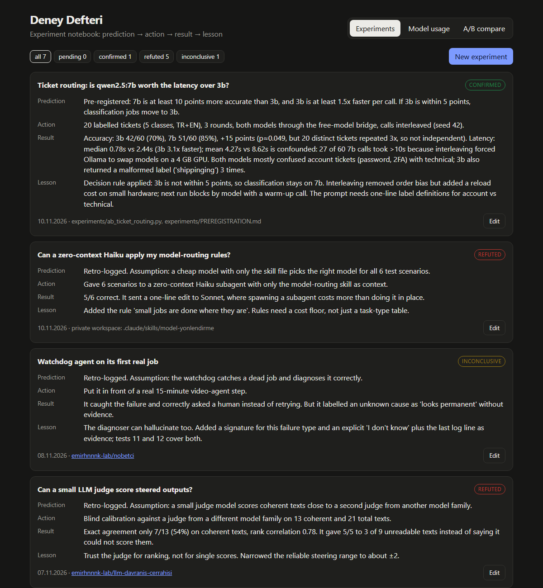
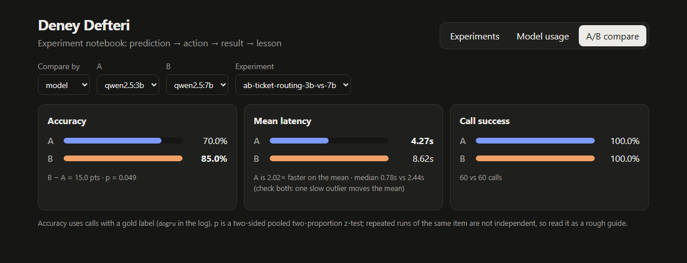

# Deney Defteri: experiment notebook

*Deney defteri* is Turkish for "lab notebook". This is a small full-stack app where I keep my experiments as **prediction → action → result → lesson**. It also imports the usage log of my free-model bridge, so I can see which model handled which job, how fast it was, and whether the answer was right. It includes an A/B view to compare two models on the same job.

**Stack:** Go (net/http, pgx) · PostgreSQL 16 · React + TypeScript (Vite).



## Why it exists

I work with coding agents every day, and I make many small decisions: which model runs which job, whether a prompt change helped, whether an agent is actually doing what it reports. I used to keep these in notes. Writing the prediction down *before* the run, and then the number afterwards, catches more of my own mistakes than anything else I do. The seed data is my real log. Six of the eight entries are "refuted": what I believed was not what the measurement showed.

This was also my first time writing Go, React/TypeScript or a PostgreSQL schema. I built it in one evening (2026-11-10) to learn the stack on a problem I actually have.

## What it does

| View | What you see |
|---|---|
| **Experiments** | Cards with prediction, action, result, lesson, outcome (`pending` / `confirmed` / `refuted` / `inconclusive`) and the source repo. Create and edit them. **The prediction cannot be edited after creation**, because changing it after the result would defeat the point. |
| **Model usage** | Per-model calls, success rate, accuracy (when a gold label exists), mean and median latency, plus the latest calls. "Import log" reads the bridge's JSONL again. Lines already imported are skipped. |
| **A/B compare** | Choose a dimension (model / provider / task), two values and, if you want, an experiment id. The view shows accuracy with a two-proportion z-test, latency (mean *and* median) and call success. It warns when an arm has fewer than 30 calls or no graded calls. |



## A real experiment in the data

`experiments/` holds a pre-registered A/B test I ran while building this: **qwen2.5:3b vs qwen2.5:7b on routing 20 labelled support tickets** (Turkish and English, 5 classes, 3 rounds). The prediction and decision rule were written down before the first run ([PREREGISTRATION.md](experiments/PREREGISTRATION.md)). The calls go through the bridge's own request and logging code, so the rows sit in the same log as my daily usage.

Result ([RESULTS.md](experiments/RESULTS.md)): 7b 85% vs 3b 70% accuracy, so classification stays on 7b. The latency comparison is the more interesting part. I interleaved the calls to avoid order bias, and on my 4 GB GPU that made Ollama swap the two models in and out of memory. 27 of the 60 7b calls took more than 10 s. The mean says 3b is 2x faster, the median says 3.1x, and neither is a clean number. That is why the A/B view always shows both. My next run will test each model as a separate block, with a warm-up call.

## Run it

Needs Go (go.mod targets 1.23; built and tested with 1.27) and Node 20+ (tested with 26). **No Docker and no PostgreSQL install:** if `DATABASE_URL` is not set, the server starts a real PostgreSQL 16 as a child process ([embedded-postgres](https://github.com/fergusstrange/embedded-postgres)). The binaries are downloaded once from Maven Central and cached.

```bash
cd web && npm install && npm run build && cd ..
cd backend
go run ./cmd/server -log path/to/kullanim_log.jsonl
# open http://127.0.0.1:8080
```

Flags: `-db` (or `DATABASE_URL`) to use your own Postgres, `-data` for the embedded data directory (default `.pgdata`), `-tz` for the time zone the bridge wrote its timestamps in (default `Europe/Istanbul`), `-seed` for the experiments file to upsert on start, `-static` for the web build. For UI development, run `npm run dev` in `web/`. Vite forwards `/api` to `:8080`.

Seeded experiments are matched by `slug`, and `seed/experiments.json` is their source of truth: an edit made in the UI to a seeded experiment is overwritten on the next start. Experiments you create in the UI have no slug and are never touched.

## Tests

```bash
cd backend
go test ./...          # 17 tests; store and devdb tests start real Postgres servers (~1 min)
go test -short ./...   # parsers, statistics and HTTP handlers only
```

- `usagelog`: parses the bridge's real log format, including failed calls with no model or duration. It skips corrupt lines and reports their line numbers instead of failing the whole import. Hashes stay stable, so a re-import never creates duplicates.
- `abtest`: z-test p-value checked against a reference value. No data means "no rate", not 0%. Small-sample and ungraded warnings.
- `api`: validation, 404/400 paths, that internal errors don't leak database details, that import reads only the configured file (a path in the request is ignored), and that unknown A/B dimensions are rejected.
- `store` (real Postgres): experiment lifecycle (the prediction stays locked, `decided_at` is set when the outcome is decided), CHECK constraint mapping, idempotent import, per-arm aggregates (durations count only successful calls), experiment filter, seed upsert.
- `devdb` (real Postgres): recovers when a previous server was left running on the same data directory.

Two of these tests come from bugs that only showed up when I ran the whole thing (see below).

## How I work: Claude Code as the engineering loop

I don't write code by hand. I write the brief, the rules and the definition of done. A coding agent (Claude Code) writes and runs the code, and I review the behaviour before anything ships. This project was built that way, and the setup around it is what makes that workable:

- **Hooks.** A `SessionStart` hook (`.claude/hooks/oturum_basi.py`) adds today's plan and my open-tasks list to the first message of every session. Memory and skills only give information; the hook puts the state in front of the agent at every session start.
- **Skills.** Project skills hold the procedures I don't want re-explained: `gonderim-denetimi` (every outgoing text passes a two-layer check before I'm asked to send it), `mail-taslagi`, `model-yonlendirme` (which model and effort level for which job, based on the real usage limits), `musteri-turu` and `video-hatti`.
- **MCP.** `belas-kopru` ("free bridge") is a small MCP server I had the agent build in Python. It sends bulk jobs (summaries, translation, classification, rough drafts) to free-tier or local models. The result goes to a file, and only a short preview comes back, which saves context and quota. Jobs marked sensitive go only to the local Ollama model. Every call is appended to `kullanim_log.jsonl`. That log is what this app reads.
- **Subagents.** Layer 2 of the outgoing-text check is a zero-context Haiku subagent. It sees only the auditor instructions and the text, not my reasoning, so it can't be talked into agreeing. When it catches something new, the case goes into a deterministic checker and its eval set (21 cases now). For large mechanical jobs I use cheaper subagents. Decisions stay in the main session.
- **Context discipline.** Long sessions get worse as they fill up. When a block of work ends, the agent writes a hand-off note and a fresh session continues from it. A personal knowledge vault keeps the decisions and open items between sessions.

### What went wrong while building this, and how it was caught

1. **`initdb` crashed under the Turkish Windows locale** (exit `0xC0000409`). The data directory was created and then deleted again. Fix: pin the cluster to locale `C` and encoding `UTF8` ([devdb.go](backend/internal/devdb/devdb.go)).
2. **Green tests, broken app.** The first full start failed with `inconsistent types deduced for parameter $9`: the seed upsert used one parameter as both a column value and a `CASE` result. No test covered the upsert. Fix: explicit casts, plus `TestUpsertExperimentBySlug`.
3. **Stopping the server hard left PostgreSQL running.** The next start failed on `postmaster.pid`. Fix: persistent data directories get a fixed runtime directory, and on start the server stops an orphaned server through `pg_ctl`. `TestStartRecoversFromOrphanedServer` reproduces the problem. I checked that it fails with the fix disabled and passes with it.
4. **The first import ran while the A/B experiment was still writing.** One row was missing from the dashboard. Pressing Import again added exactly that row (`read 121, inserted 1`), so the hash-based de-duplication was proven on real data.
5. **The A/B latency was confounded** by model swapping on a 4 GB GPU (see above). The data stayed as it was, and the write-up says so.

## Layout

```
backend/
  cmd/server/          main: flags, embedded Postgres, seed, import, HTTP server
  internal/usagelog/   JSONL parser for the bridge's log
  internal/abtest/     arm aggregates, two-proportion z-test, warnings
  internal/store/      PostgreSQL schema and queries (pgx)
  internal/api/        JSON handlers (Go 1.22+ routing patterns)
  internal/devdb/      embedded PostgreSQL for dev and tests
  seed/experiments.json
web/src/               React + TypeScript views (Experiments, Usage, A/B)
experiments/           A/B script, pre-registration, raw run output, results
```

## Limits

- Single user, no authentication. It listens on `127.0.0.1` by default and is not meant to be exposed.
- The seven seeded experiments other than the A/B test were logged **retroactively** from my project notes. Their "prediction" is the assumption I was working under at the time, and each one links to the repo with the evidence. Only the A/B test was pre-registered.
- The statistics are deliberately basic. The z-test assumes independent samples, and repeated runs of the same ticket are not independent, so the view says this next to the p-value.
